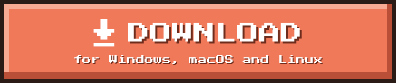
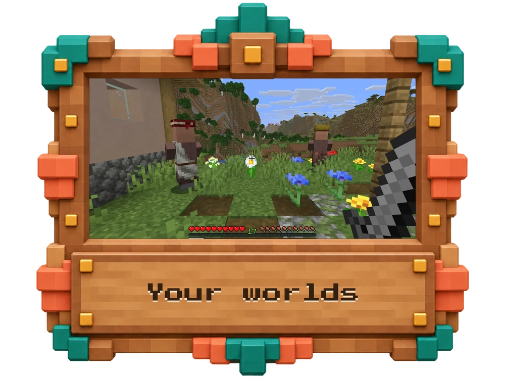
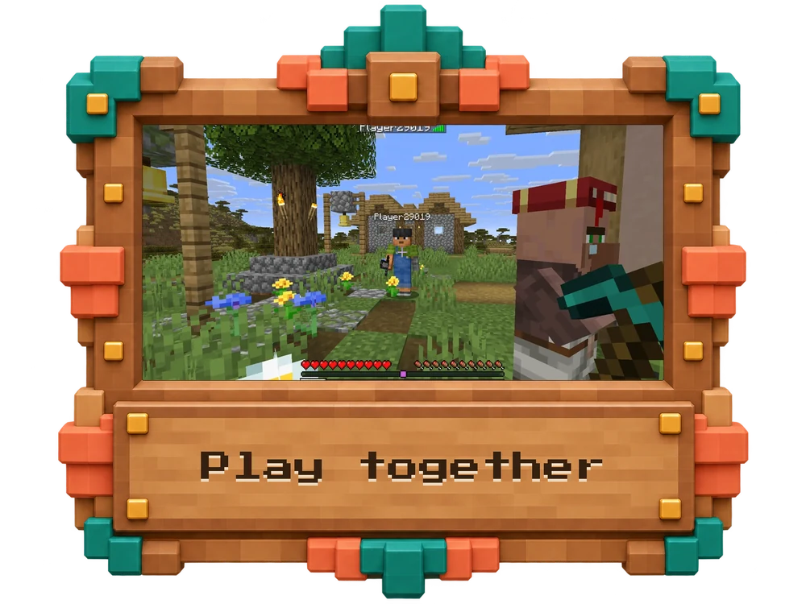
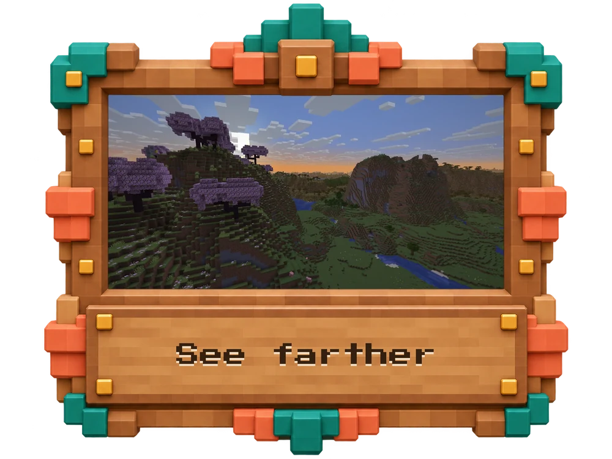
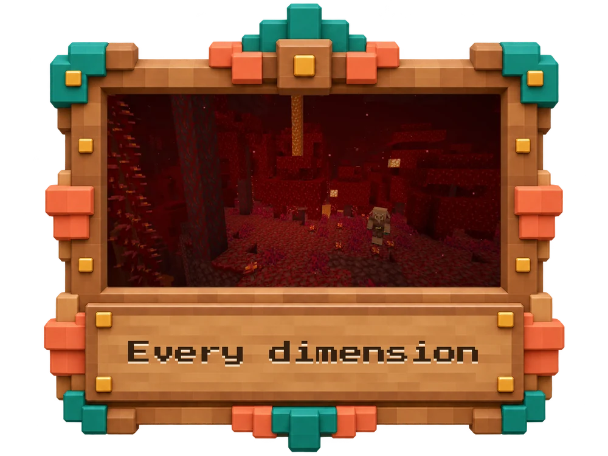
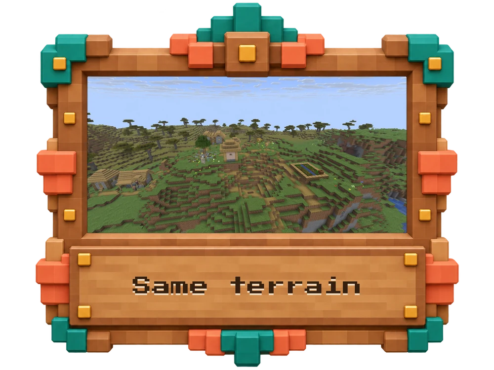
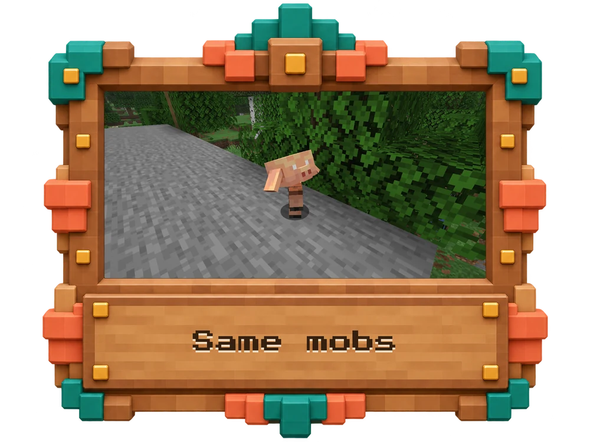
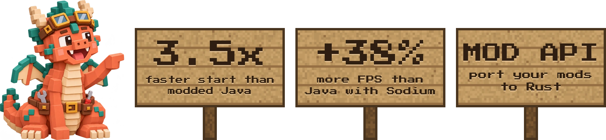

> [!IMPORTANT]
> **Discord:** join Modrizon, the working server for the mod API effort (mod developers, testers, contributors): [discord.gg/j5qs5tZTrZ](https://discord.gg/j5qs5tZTrZ). A side room for modding work; Horizon's own server stays the place for the game.
>
> **This is arismoko/horizon, a fork of [horizon-rust/horizon](https://github.com/horizon-rust/horizon) for modding work. It is not the official Horizon repository.**
>
> - **What's different:** this fork builds Horizon's mod API: native hooks, the `Host`, handles, Parts, attachments, mod loading and WebAssembly mods. The mod API here is under active development and changes in ways upstream's doesn't. Start at the pinned issue, [#771](https://github.com/arismoko/horizon/issues/771), which links the [project board](https://github.com/users/arismoko/projects/1) and says where the mod API is going. The modder docs are in [`docs/modding/`](docs/modding/).
> - **Kept in step with upstream:** upstream's main is merged in regularly. Changes that differ from upstream are marked "Diverges from upstream" in their pull requests.
> - **Where to report things:** modding proposals, API gaps and mod-loading bugs go in this fork's [issues](https://github.com/arismoko/horizon/issues). Game bugs that have nothing to do with modding belong upstream, at [horizon-rust/horizon](https://github.com/horizon-rust/horizon/issues).
> - **Downloads:** the [fork launcher](https://github.com/arismoko/horizon/releases?q=launcher%40&expanded=true) is published for Linux x86_64, Windows x64 and macOS Apple Silicon (arm64 only), with separate settings, game data, accounts and updates. Microsoft sign-in is configured using upstream's application with permission; signed Nightly Play requires an account that owns Minecraft. macOS packages are ad hoc signed, not notarized: on macOS 14 and earlier, right-click the app and choose Open, then confirm Open; on macOS 15 and later, open it once, then use System Settings › Privacy & Security › Open Anyway and confirm. Windows packages are not Authenticode-signed: expect SmartScreen or unknown-publisher warnings. The launcher installs this fork's [signed Nightlies](https://github.com/arismoko/horizon/releases/tag/nightly); dedicated servers and exact source pins for native mods are also available there. For client development without sign-in, [build an unsigned developer base from source](docs/modding/src/how-to/native-mods/07-local-developer-builds.md) and opt into single-player-only Play with `HORIZON_LAUNCHER_DEVELOPER_OFFLINE=1`; this does not enable signed Nightly Play. The official launcher, website and stable releases below are upstream's, not this fork's.
> - **Recent developments:** [Generated daily changelog](https://github.com/arismoko/horizon/blob/changelog/CHANGELOG.md), refreshed every 12 hours.
> - **How it's maintained:** day-to-day work on this fork is done by Aria's agent swarm, Dyna, with reviews on every pull request.

<p align="center">
  
</p>

<p align="center">
<<<<<<< ours
  <a href="https://playhorizon.dev"><b>Website</b></a> ·
  <a href="#download"><b>Download</b></a> ·
  <a href="https://playhorizon.dev/docs/"><b>Docs</b></a> ·
  <a href="ROADMAP.md"><b>Roadmap</b></a> ·
  <a href="#contributing"><b>Contributing</b></a>
||||||| base
  <a href="https://playhorizon.dev"><b>Website</b></a> ·
  <a href="#download"><b>Download</b></a> ·
  <a href="https://playhorizon.dev/docs/"><b>Docs</b></a> ·
  <a href="https://discord.gg/playhorizon"><b>Discord</b></a> ·
  <a href="ROADMAP.md"><b>Roadmap</b></a> ·
  <a href="#contributing"><b>Contributing</b></a>
=======
  <b>Minecraft: Java Edition 26.3, rebuilt from scratch in Rust.</b><br>
  The same rules and the same terrain, your own worlds, in one native program without Java.
>>>>>>> theirs
</p>

<p align="center">
  <a href="https://playhorizon.dev"></a>
</p>

<p align="center">
  <a href="https://github.com/horizon-rust/horizon/stargazers"></a>
  <a href="https://discord.gg/playhorizon"></a>
  <a href="https://github.com/horizon-rust/horizon/graphs/contributors"></a>
  <a href="LICENSE"></a>
</p>

<p align="center">
  <a href="https://playhorizon.dev"><b>Website</b></a> ·
  <a href="https://playhorizon.dev/docs/"><b>Docs</b></a> ·
  <a href="https://playhorizon.dev/docs/install"><b>Install guide</b></a> ·
  <a href="https://discord.gg/playhorizon"><b>Discord</b></a> ·
  <a href="ROADMAP.md"><b>Roadmap</b></a>
</p>

<p align="center">
  
</p>

<p align="center">
  
  
</p>

<p align="center">
  
  
</p>

<p align="center">
  
  
</p>

<p align="center">
  <b>On the roadmap:</b> play in your browser · Android and iOS with mods · splitscreen · <a href="ROADMAP.md">see the roadmap</a>
</p>

<p align="center">
  
</p>

<p align="center">
  <sub>Against Java Edition with Sodium, Lithium, FerriteCore and ImmediatelyFast on a Ryzen 7 9800X3D with an RTX 5080: the title screen in about 3 seconds instead of 11, and 31 to 38 percent more frames per second across render distances.</sub>
</p>

<h2 align="center">Made by the Horizon Team</h2>

<table align="center">
  <tr>
    <td align="center" width="140"><a href="https://github.com/kacpherek"><br><b>Kacper</b></a></td>
    <td align="center" width="140"><a href="https://github.com/Online5277"><br><b>Cosmic</b></a></td>
    <td align="center" width="140"><a href="https://github.com/levzzz5154"><br><b>levzzz</b></a></td>
    <td align="center" width="140"><a href="https://github.com/rdbtCVS"><br><b>rdbt</b></a></td>
    <td align="center" width="140"><a href="https://github.com/dezer-x"><br><b>Anthony S</b></a></td>
    <td align="center" width="140"><a href="https://github.com/ludovic111"><br><b>Ludovic Marie</b></a><br><sub>Founder</sub></td>
  </tr>
</table>

<<<<<<< ours
## Mods and shader packs

- **Content mods** (`.hmod`): blocks, items, recipes, loot, models and textures, with no code.
- **Native mods** (`.hnmod`): Rust that the launcher compiles into the game for you, with nothing to install.
- **Java mods** (Fabric, NeoForge, Forge) don't run: Horizon has no Java. The launcher carries over the data and assets inside their jars, and imports modpacks (`.mrpack`, CurseForge zips, Prism instances) the same way ([modpacks](https://playhorizon.dev/docs/modpacks)).
- **Shader packs**: Iris/OptiFine-format packs (`shaders/` folders) and Horizon's own WGSL packs, under Video Settings → Shader Packs ([pack format](docs/shaders.md)).

Mods are off by default: a fresh install plays exactly like vanilla 26.3. The launcher's Mods page browses Horizon's registry and Modrinth. [Mods](https://playhorizon.dev/docs/mods) · [make a mod](docs/mods.md).

## Host a server

The launcher's **Servers** page creates, starts, backs up and updates a server, and invites friends. On a VPS, `horizon-server` installs with one command, needs no Java, and takes vanilla 26.3 and Horizon players alike. [Host a server](https://playhorizon.dev/docs/hosting) ([reference](docs/hosting.md)).

## Agent control

AI agents and scripts can play Horizon. `horizon-ctl`, shipped with the game, reads its state as JSON and acts like a player; `horizon-ctl mcp` serves the same commands over MCP.

```sh
horizon-ctl launch --world Survival --seed 5 --wait   # finds the version the launcher installed
horizon-ctl state                                       # position, health, food, target, screen...
horizon-ctl goto -0.5 65 -2.5 --near 2.5                # walks there along a path
horizon-ctl break -1 65 -3                              # mines it; replies with the drops
```

`horizon-ctl help` lists every command. [Agent control](docs/native-client.md#agent-control-horizon-ctl-and-mcp).

## Build from source

Needs Rust 1.90+, Python 3.11+, JDK 25, and on Linux `libasound2-dev libudev-dev`. `horizon-prepare` builds the game's resources from **your own copy** of Java Edition 26.3 (checked against `research-lock.json`) and never downloads it:

1. **Client:** play 26.3 once in the official launcher. Horizon reads `~/.minecraft` (or `--minecraft-dir` / `HORIZON_MINECRAFT_DIR`).
2. **Server jar:** the 26.3 server jar (`downloads.server.url` in `versions/26.3/26.3.json`), passed once with `--server-jar` or `HORIZON_SERVER_JAR`.

```sh
git clone https://github.com/horizon-rust/horizon.git
cd horizon
cargo run --release -p horizon-prepare -- --prepare --server-jar ~/Downloads/server.jar   # needs JDK 25
cargo run --release -p horizon-prepare -- sounds   # optional: sounds from your launcher install
cargo run --release -p horizon-game
```

Prepared files land in the gitignored `.local/`: never commit or share them. Options, controls and architecture: [the native client guide](docs/native-client.md); all developer docs: [docs/README.md](docs/README.md).

## Contributing

Issues and pull requests are welcome: read [CONTRIBUTING.md](CONTRIBUTING.md) (vanilla first, small pull requests). Questions: this fork's [issues](https://github.com/arismoko/horizon/issues). Before a pull request, run the self-check and paste its output:

```sh
git config core.hooksPath .githooks
python3 tools/pr_ready.py
```

It runs rustfmt, clippy, the touched crates' tests, the Python tests, the public-tree check and the vanilla harnesses your change affects. Never commit game files, decompiled source or prepared resources.

How Horizon is run (the council, theme groups and their leads, the Horizon Team, moderation): [GOVERNANCE.md](GOVERNANCE.md).

## Project status

**Player-visible gaps: 0 open** of the 833 the [port ledger](tools/port_ledger.py) found, reading every vanilla 26.3 method against Horizon's code: vanilla behaviour a player would notice that Horizon doesn't have yet. By area: Animals [0](https://github.com/horizon-rust/horizon/issues/3512); Monsters and bosses [0](https://github.com/horizon-rust/horizon/issues/3513); Entities, projectiles, vehicles and decorations [0](https://github.com/horizon-rust/horizon/issues/3514); Items, enchantments and inventories [0](https://github.com/horizon-rust/horizon/issues/3515); Blocks, redstone and fluids [0](https://github.com/horizon-rust/horizon/issues/3516); World, world generation and saves [0](https://github.com/horizon-rust/horizon/issues/3517); Screens, HUD and client packets [0](https://github.com/horizon-rust/horizon/issues/3518); Entity and block rendering, models [0](https://github.com/horizon-rust/horizon/issues/3519); Server and players on the server [0](https://github.com/horizon-rust/horizon/issues/3520); Mob AI, villagers and raids [0](https://github.com/horizon-rust/horizon/issues/3521). This number goes down as gaps close (`tools/parity_gaps.py`); the table below says what the harnesses compare.

The table is the project's own audit of what the harnesses compare, subsystem by subsystem: a score says how much of that subsystem the harnesses cover and pass, not that nothing else differs from vanilla. What players still run into: [known issues](docs/known-issues.md).

### What the harnesses compare

Scores: 0 (absent), 0.25 (started), 0.5 (playable, major features missing), 0.75 (mostly complete) or 1 (its harnesses cover the subsystem and pass). Last audited 2026-10-13: the harnesses pass on Linux and macOS. The [port ledger](tools/port_ledger.py) adds a method-by-method view of what is ported.

| Subsystem | Score | Main gaps |
| --- | ---: | --- |
| Window, input and game loop | 1 | None: game loop, options, camera, auto-jump, toggle sprint/sneak and frame limiter match |
| Assets and resources | 1 | None: item models match over 196,290 stacks; the resource pack screen over 3,000 sessions |
| Network protocol and multiplayer | 1 | None: joins vanilla servers; the dedicated server matches vanilla's files, login, configuration, play and command tree; LAN discovery over 462 cases (offline mode only) |
| Chunk storage and palettes | 1 | None: client and saves share paletted containers, identical to vanilla over 266 scenarios |
| Section meshing | 1 | None: 112 scenes and over a million quads identical to vanilla |
| Rendering | 1 | None: entity models, block entity renderers (407 cases) and animations (296), HUD overlays (2,200 states), the recipe book (600), player list, subtitles and world border match |
| Lighting | 1 | None: saved and relit light matches vanilla, slabs and stairs included |
| World generation | 1 | None: 2,352 whole chunks over 225 structure sites, in all three dimensions, identical to vanilla |
| Region files and saves | 1 | None: saves round-trip with vanilla; worlds from 1.8 to 26.2 upgrade as vanilla's DataFixers do |
| Entities and physics | 1 | None: attributes, spawn rules, natural spawning (15,500 cases), raids and patrols (1,900), `finalizeSpawn` (24,000) and mob AI (92 scenarios) match |
| Interaction and inventory | 1 | None: menu clicks over 8,000 sequences; recipe book placement (6,000), buttons (1,200), saved book (1,500), loom and crafter screens (1,600) |
| Menus, HUD and chat | 1 | None: every command (758 over 39,685 inputs), scoreboards (81,000 operations), the player list (872,000 draw calls), chat and its suggestions (3,000 sessions) match |
| Audio | 1 | None: the sound engine, sound events, music, situational music, ambience and subtitles match vanilla |
| Block behaviours and ticking | 1 | None: block updates, random ticks, redstone, dispensers (6,000 cases), crafters (4,000), container spills (4,000), copper golems and the sculk family (435 scenarios) match |
||||||| base
## Mods and shader packs

- **Content mods** (`.hmod`): blocks, items, recipes, loot, models and textures, with no code.
- **Native mods** (`.hnmod`): Rust that the launcher compiles into the game for you, with nothing to install.
- **Java mods** (Fabric, NeoForge, Forge) don't run: Horizon has no Java. The launcher carries over the data and assets inside their jars, and imports modpacks (`.mrpack`, CurseForge zips, Prism instances) the same way ([modpacks](https://playhorizon.dev/docs/modpacks)).
- **Shader packs**: Iris/OptiFine-format packs (`shaders/` folders) and Horizon's own WGSL packs, under Video Settings → Shader Packs ([pack format](docs/shaders.md)).

Mods are off by default: a fresh install plays exactly like vanilla 26.3. The launcher's Mods page browses Horizon's registry and Modrinth. [Mods](https://playhorizon.dev/docs/mods) · [make a mod](docs/mods.md).

## Host a server

The launcher's **Servers** page creates, starts, backs up and updates a server, and invites friends. On a VPS, `horizon-server` installs with one command, needs no Java, and takes vanilla 26.3 and Horizon players alike. [Host a server](https://playhorizon.dev/docs/hosting) ([reference](docs/hosting.md)).

## Agent control

AI agents and scripts can play Horizon. `horizon-ctl`, shipped with the game, reads its state as JSON and acts like a player; `horizon-ctl mcp` serves the same commands over MCP.

```sh
horizon-ctl launch --world Survival --seed 5 --wait   # finds the version the launcher installed
horizon-ctl state                                       # position, health, food, target, screen...
horizon-ctl goto -0.5 65 -2.5 --near 2.5                # walks there along a path
horizon-ctl break -1 65 -3                              # mines it; replies with the drops
```

`horizon-ctl help` lists every command. [Agent control](docs/native-client.md#agent-control-horizon-ctl-and-mcp).

## Build from source

Needs Rust 1.90+, Python 3.11+, JDK 25, and on Linux `libasound2-dev libudev-dev`. `horizon-prepare` builds the game's resources from **your own copy** of Java Edition 26.3 (checked against `research-lock.json`) and never downloads it:

1. **Client:** play 26.3 once in the official launcher. Horizon reads `~/.minecraft` (or `--minecraft-dir` / `HORIZON_MINECRAFT_DIR`).
2. **Server jar:** the 26.3 server jar (`downloads.server.url` in `versions/26.3/26.3.json`), passed once with `--server-jar` or `HORIZON_SERVER_JAR`.

```sh
git clone https://github.com/horizon-rust/horizon.git
cd horizon
cargo run --release -p horizon-prepare -- --prepare --server-jar ~/Downloads/server.jar   # needs JDK 25
cargo run --release -p horizon-prepare -- sounds   # optional: sounds from your launcher install
cargo run --release -p horizon-client
```

Prepared files land in the gitignored `.local/`: never commit or share them. Options, controls and architecture: [the native client guide](docs/native-client.md); all developer docs: [docs/README.md](docs/README.md).

## Contributing

Issues and pull requests are welcome: read [CONTRIBUTING.md](CONTRIBUTING.md) (vanilla first, small pull requests), and see [ROADMAP.md](ROADMAP.md) or [playhorizon.dev/hub](https://playhorizon.dev/hub) for what's next. Questions: [Discord](https://discord.gg/playhorizon). Before a pull request, run the self-check and paste its output:

```sh
git config core.hooksPath .githooks
python3 tools/pr_ready.py
```

It runs rustfmt, clippy, the touched crates' tests, the Python tests, the public-tree check and the vanilla harnesses your change affects. Never commit game files, decompiled source or prepared resources.

How Horizon is run (the council, theme groups and their leads, the Horizon Team, moderation): [GOVERNANCE.md](GOVERNANCE.md).

## Project status

**Player-visible gaps: 0 open** of the 833 the [port ledger](tools/port_ledger.py) found, reading every vanilla 26.3 method against Horizon's code: vanilla behaviour a player would notice that Horizon doesn't have yet. By area: Animals [0](https://github.com/horizon-rust/horizon/issues/3512); Monsters and bosses [0](https://github.com/horizon-rust/horizon/issues/3513); Entities, projectiles, vehicles and decorations [0](https://github.com/horizon-rust/horizon/issues/3514); Items, enchantments and inventories [0](https://github.com/horizon-rust/horizon/issues/3515); Blocks, redstone and fluids [0](https://github.com/horizon-rust/horizon/issues/3516); World, world generation and saves [0](https://github.com/horizon-rust/horizon/issues/3517); Screens, HUD and client packets [0](https://github.com/horizon-rust/horizon/issues/3518); Entity and block rendering, models [0](https://github.com/horizon-rust/horizon/issues/3519); Server and players on the server [0](https://github.com/horizon-rust/horizon/issues/3520); Mob AI, villagers and raids [0](https://github.com/horizon-rust/horizon/issues/3521). This number goes down as gaps close (`tools/parity_gaps.py`); the table below says what the harnesses compare.

The table is the project's own audit of what the harnesses compare, subsystem by subsystem: a score says how much of that subsystem the harnesses cover and pass, not that nothing else differs from vanilla. What players still run into: [known issues](docs/known-issues.md).

### What the harnesses compare

Scores: 0 (absent), 0.25 (started), 0.5 (playable, major features missing), 0.75 (mostly complete) or 1 (its harnesses cover the subsystem and pass). Last audited 2026-10-13: the harnesses pass on Linux and macOS. The [port ledger](tools/port_ledger.py) adds a method-by-method view of what is ported.

| Subsystem | Score | Main gaps |
| --- | ---: | --- |
| Window, input and game loop | 1 | None: game loop, options, camera, auto-jump, toggle sprint/sneak and frame limiter match |
| Assets and resources | 1 | None: item models match over 196,290 stacks; the resource pack screen over 3,000 sessions |
| Network protocol and multiplayer | 1 | None: joins vanilla servers; the dedicated server matches vanilla's files, login, configuration, play and command tree; LAN discovery over 462 cases (offline mode only) |
| Chunk storage and palettes | 1 | None: client and saves share paletted containers, identical to vanilla over 266 scenarios |
| Section meshing | 1 | None: 112 scenes and over a million quads identical to vanilla |
| Rendering | 1 | None: entity models, block entity renderers (407 cases) and animations (296), HUD overlays (2,200 states), the recipe book (600), player list, subtitles and world border match |
| Lighting | 1 | None: saved and relit light matches vanilla, slabs and stairs included |
| World generation | 1 | None: 2,352 whole chunks over 225 structure sites, in all three dimensions, identical to vanilla |
| Region files and saves | 1 | None: saves round-trip with vanilla; worlds from 1.8 to 26.2 upgrade as vanilla's DataFixers do |
| Entities and physics | 1 | None: attributes, spawn rules, natural spawning (15,500 cases), raids and patrols (1,900), `finalizeSpawn` (24,000) and mob AI (92 scenarios) match |
| Interaction and inventory | 1 | None: menu clicks over 8,000 sequences; recipe book placement (6,000), buttons (1,200), saved book (1,500), loom and crafter screens (1,600) |
| Menus, HUD and chat | 1 | None: every command (758 over 39,685 inputs), scoreboards (81,000 operations), the player list (872,000 draw calls), chat and its suggestions (3,000 sessions) match |
| Audio | 1 | None: the sound engine, sound events, music, situational music, ambience and subtitles match vanilla |
| Block behaviours and ticking | 1 | None: block updates, random ticks, redstone, dispensers (6,000 cases), crafters (4,000), container spills (4,000), copper golems and the sculk family (435 scenarios) match |
=======
<p align="center">
  <sub>and everyone who has contributed</sub><br><br>
  <a href="https://github.com/horizon-rust/horizon/graphs/contributors"></a>
</p>
>>>>>>> theirs

<p align="center">
  <a href="docs/native-client.md#run-from-a-checkout"><b>Build guide</b></a> ·
  <a href="CONTRIBUTING.md"><b>Contributing</b></a> ·
  <a href="GOVERNANCE.md"><b>Governance</b></a> ·
  <a href="https://discord.gg/playhorizon"><b>Discord</b></a>
</p>

<<<<<<< ours
[MIT](LICENSE), for the project's original work; dependencies keep their own licences ([notices](THIRD_PARTY_NOTICES.md)). Horizon is made by [Ludovic Marie](https://lu4ovic.com) ([@ludovic111](https://github.com/ludovic111)) and [its contributors](https://github.com/horizon-rust/horizon/graphs/contributors).
||||||| base
[MIT](LICENSE), for the project's original work; dependencies keep their own licences ([notices](THIRD_PARTY_NOTICES.md)). Horizon is made by [Ludovic Marie](https://lu4ovic.com) ([@ludovic111](https://github.com/ludovic111)) and [its contributors](https://github.com/horizon-rust/horizon/graphs/contributors); support it on [GitHub Sponsors](https://github.com/sponsors/ludovic111).
=======
<sub>Horizon is released under the [MIT licence](LICENSE) for the project's original work; dependencies keep their own licences, see the [notices](THIRD_PARTY_NOTICES.md). Founded by [Ludovic Marie](https://lu4ovic.com) and built by the Horizon Team and [its contributors](https://github.com/horizon-rust/horizon/graphs/contributors). You can support it on [GitHub Sponsors](https://github.com/sponsors/ludovic111).</sub>
>>>>>>> theirs

<sub>NOT AN OFFICIAL MINECRAFT PRODUCT. NOT APPROVED BY OR ASSOCIATED WITH MOJANG OR MICROSOFT. Minecraft is a trademark of Mojang Synergies AB; its code and assets belong to Mojang and Microsoft under the [Minecraft EULA](https://www.minecraft.net/en-us/eula).</sub>
